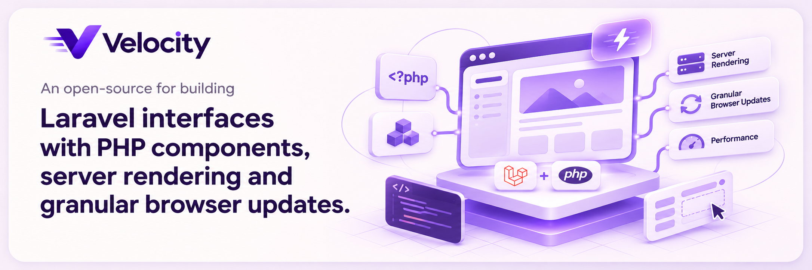

    

<h3 align="center">From idea to interactive app. In PHP.</h3>

We're building **Velocity**, an open-source UI framework for Laravel. Create admin panels, customer portals, dashboards and public pages with PHP components. Forms, tables, actions and layouts share one system, with server rendering and granular browser updates.

    <a href="https://github.com/velocity-php/velocity">Explore the framework</a> ·
    <a href="https://github.com/velocity-php/velocity/blob/main/docs/README.md">Read the docs</a> ·
    <a href="https://github.com/velocity-php/velocity/blob/main/CONTRIBUTING.md">Build with us</a>

PHP 8.3+ · Laravel 12 & 13 · [MIT licensed](https://github.com/velocity-php/velocity/blob/main/LICENSE) · Experimental
